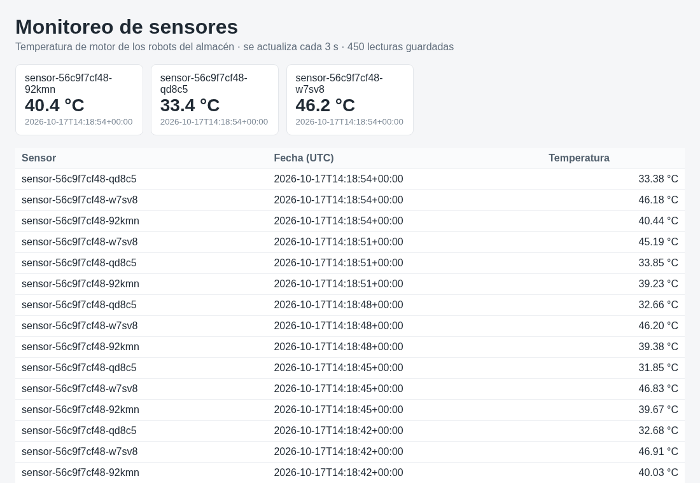

# k8s-redis-sensores

[](https://github.com/Whiteherobot/k8s-redis-sensores/actions/workflows/ci.yml)

Monitoreo en tiempo real de los robots de un almacén automatizado, desplegado
en Kubernetes: tres sensores publican la temperatura del motor en Redis cada
3 segundos y un panel web muestra la última lectura de cada uno y el
historial. Redis guarda los datos en un volumen persistente, con clave en un
Secret. Evaluación de Sistemas Distribuidos (febrero de 2026).



## Componentes

| Componente | Imagen | Detalle |
|---|---|---|
| Redis | `redis:7.4-alpine` | AOF cada segundo sobre un PVC de 1 Gi, clave obligatoria, estrategia `Recreate`. |
| Sensor (3 réplicas) | `logistica/sensor:1.0` (`apps/sensor`) | Cada réplica usa el nombre de su pod como id. Guarda en `sensor:data` (lista, últimas 1000) y `sensor:latest` (hash con la última de cada sensor), en una transacción. |
| Panel (2 réplicas) | `logistica/panel:1.0` (`apps/panel`) | Flask con gunicorn, solo lectura, NodePort 30081. `/api/lecturas` devuelve lo mismo en JSON. |

Cada lectura es `{"sensor_id": "...", "valor": 41.3, "timestamp": "2026-10-17T14:18:54+00:00"}`.

## Cómo correrlo

```bash
kind create cluster --config scripts/kind.yaml   # o minikube
scripts/desplegar.sh      # construye y carga las imágenes, crea el Secret y aplica k8s/
scripts/probar.sh         # verifica todo (ver abajo)
scripts/limpiar.sh
```

El panel queda en `http://localhost:30081` con kind, o en
`http://$(minikube ip):30081` con minikube (para `probar.sh`, `URL_PANEL=...`).
La clave de Redis se genera al desplegar y queda en el Secret
`redis-credentials`; para mirar los datos:

```bash
kubectl -n logistica-system exec deploy/redis -- sh -c 'redis-cli -a "$REDIS_PASSWORD" LRANGE sensor:data 0 4'
```

## Qué verifica `probar.sh`

1. Los 3 sensores están publicando y hay lecturas guardadas.
2. El panel muestra los 3 sensores.
3. Redis rechaza comandos sin clave.
4. Se borra el pod de Redis: Kubernetes lo recrea, las lecturas siguen ahí y la
   más vieja es la misma.
5. Los sensores vuelven a escribir solos y ninguno se reinició (reintentan con
   espera creciente en vez de terminar).

La CI hace lo mismo en un clúster kind, además de las pruebas de Python
(`pytest`, con `fakeredis`).

## Qué se corrigió

- **Probes que no probaban nada.** `redis-cli ping` termina con código 0
  aunque la respuesta sea `NOAUTH`, así que Redis se daba por listo aunque la
  clave estuviera mal. Ahora se exige `PONG`.
- **Actualizar Redis se trababa.** Con un volumen `ReadWriteOnce` y
  `RollingUpdate`, el pod nuevo espera un disco que sigue montado en el viejo.
  Ahora la estrategia es `Recreate`.
- **Base de datos expuesta.** Redis Commander quedaba publicado en un NodePort
  con usuario y clave vacíos: cualquiera en la red podía leer y borrar todo.
  Se quitó; el panel es de solo lectura y para inspeccionar está `kubectl exec`.
- **Clave en el repositorio.** El Secret con `SecurePassword123!` (en base64,
  que no es cifrado) estaba versionado; ahora se genera al desplegar.
- **`pip install` en cada arranque.** Los pods instalaban dependencias al
  iniciar: cada reinicio dependía de PyPI. Ahora hay imágenes propias.
- **Un solo sensor y caídas al arrancar.** El sensor terminaba si Redis no
  estaba listo (CrashLoopBackOff hasta que lo estuviera) y era uno solo. Ahora
  son tres, reintentan y escriben historial y última lectura en una sola
  transacción.
- **Lo demás.** Versiones fijas, el `storageClassName` atado a minikube, el
  panel que no se desplegaba con el script (aunque el README lo nombraba), los
  scripts duplicados en PowerShell y el de limpieza que pedía confirmación.

## Autor

Michael Lata ([@Whiteherobot](https://github.com/Whiteherobot))

Licencia MIT.
